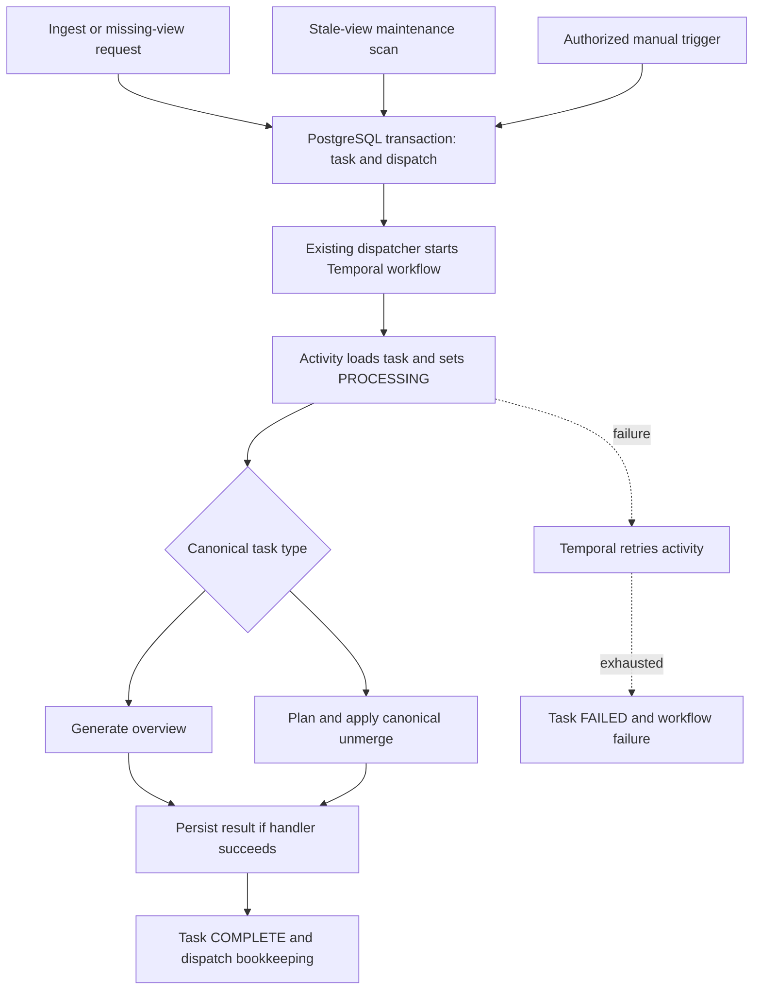

# Consolidation flow — current implementation

**2026-09-29 implementation update:** source mutations now invalidate ancestor revisions and enqueue coalesced overview work transactionally. Canonical overviews use a typed prompt, bounded descendant inputs, immutable lineage and atomic revision checks. Processing generations preserve changes arriving during a run. The descriptions below are historical; consult [IMPLEMENTATION_STATUS.md](IMPLEMENTATION_STATUS.md) for current behavior and limits.

Reviewed: 2026-09-29 against the working tree. This document describes existing behavior and confirmed limits. The [retrieval/consolidation design](RETRIEVAL_CONSOLIDATION_DESIGN.md) specifies proposed repairs and extensions; the [production plan](ORDERED_RETRIEVAL_PLAN.md) sets delivery priorities.

Consolidation maintains derived views asynchronously. User-message fact formation, session compaction and overview generation are separate operations; existing consolidation does not by itself make ordinary chat turns durable canonical facts.

## 1. Modes and execution owners

| Mode | Configuration | Implemented handlers | Execution boundary |
|---|---|---|---|
| Canonical | `canonical_memory.enabled=true`; enabled in `config.prod.yaml` | `CONSOLIDATE_OVERVIEW`, `UNMERGE_CANONICAL` | PostgreSQL canonical repository, existing outbox and Temporal workflow |
| Legacy compatibility | `canonical_memory.enabled=false`; the configuration class defaults to false | Manifest, overview propagation, atomize, normalize, temporalize, integrate and legacy unmerge | Filesystem/KG/ledger handlers; legacy polling execution remains in the repository |

Canonical mode rejects legacy task types. Do not describe legacy task names or thread-poll intervals as the canonical production pipeline. The configuration class requires Temporal for canonical mode unless that requirement is explicitly overridden; inspect the effective deployment configuration.

Source paths: [canonical handlers](../engram/consolidation/canonical.py), [dispatch and legacy worker](../engram/consolidation/worker.py), [task/outbox store](../engram/storage/postgres.py), [Temporal activities](../engram/temporal/activities.py), [workflows](../engram/temporal/workflows.py), [configuration](../engram/config.py), [consolidation API](../engram/api/routes/consolidation.py).

## 2. Canonical execution flow

The diagram describes control flow, not a claim that overview generation is currently correct for every input. The prompt failure and revision limits below remain open.

### Enqueue and dispatch

`PostgresStore.enqueue_task` creates a task with `scheduled_at=CURRENT_TIMESTAMP`, and inserts a `CONSOLIDATION` dispatch in the same transaction. The active-task unique index is **`(tenant_id, node_id, task_type)`** for `PENDING`/`PROCESSING` rows. A duplicate enqueue returns `None`; the API may report `ALREADY_QUEUED`.

The existing dispatcher claims due outbox records with fenced leases and starts `engram.consolidation` using a task ID. A dispatch claim lease governs handoff to Temporal; it is not a universal timeout/recovery lease for running consolidation activities.

The canonical stale-overview scan checks active `COLLECTION`/`PROJECT` nodes for a missing overview whose `input_revision` equals the node revision, with a default batch limit of 200. `MemoryRepository.enqueue_overview_regeneration` also requests regeneration after a current-view lookup misses. These checks depend on ordinary node revisions and do not establish complete child-source freshness.

### Activity and handlers

`process_consolidation_activity` reclaims a `PENDING` or `PROCESSING` task, establishes tenant context and invokes the controlled dispatcher. If a previous attempt already completed the task, it returns `ALREADY_PROCESSED` and finishes dispatch bookkeeping.

`consolidate_overview` currently:

1. Resolves the scope node and loads its children.
2. Calls `get_current_state` separately for each child; collects an abstract/body excerpt and canonical claim dictionaries.
3. Renders the overview prompt and calls the Core model.
4. Rejects empty output, then rereads the parent scope revision and rejects it if changed.
5. Calls `save_overview` in a separate repository transaction, then invalidates the overview cache.

`unmerge_entity` is restricted to `ENTITY` nodes. It reads a snapshot including historical claims, requests a split proposal, and applies it through `repository.unmerge_entity` with mutation identity `consolidation:{task_id}:unmerge`. This is a canonical identity correction, not ordinary summarization.

### Completion and retry

Successful dispatch updates the task to `COMPLETE`. An ordinary handler exception leaves it `PROCESSING` with an error so Temporal can retry the same durable task. Unknown task types are classified non-retryable. The consolidation workflow uses a 15-minute activity start-to-close timeout and the shared retry policy; this is not a user-facing freshness SLO.

After terminal activity failure, the workflow invokes `mark_task_failed_activity`, which records `FAILED`, then raises a workflow failure. Dispatch bookkeeping may be marked complete for both successful and terminally failed tasks because delivery is finished. **Dispatch completion does not mean consolidation succeeded.** If failure bookkeeping itself cannot complete, operator recovery/reconciliation must inspect workflow and task state rather than assume a clean terminal transition.

## 3. Confirmed limitations

| Limitation | Evidence and actual consequence |
|---|---|
| Canonical prompt fields mismatch | Handler passes `subject_id/predicate/object_entity_id/object_value`; `overview.j2` expects `subject_uri/relation/object_uri`. With a nonempty canonical relationship list, strict rendering was reproduced raising `UndefinedError` before any model call |
| Parent revision is incomplete lineage | Adding a hierarchy edge bumps the parent, but an existing child's claim change is not universally represented by that parent revision. A view can appear current under a parent-only comparison despite changed inputs |
| Validation/write are separate | The handler's reread and `save_overview` are not one conditional publication transaction. `save_overview` does not compare all expected source revisions while writing |
| Retry can overwrite an overview version | `save_overview` upserts content on the `(tenant_id, scope_id, input_revision)` conflict key. This is not immutable publication keyed by all inputs and generator policy |
| Active-job deduplication is not complete coalescing | Duplicate enqueue neither records a newer requested generation nor guarantees another run after an in-flight change |
| Declared debounce is not applied here | `overview_debounce_seconds=30` exists in configuration; this enqueue path schedules immediately. The setting alone does not prove delayed/coalesced execution |
| Input work is not bounded by output tokens | Per-child reads and collected prompt inputs can grow with scope size. `overview_max_tokens` bounds the requested output, not the entire input fanout |

The prompt mismatch is **reproduced**; the concurrency and freshness items are **inspected risks**, not reported production incidents. See [RC01–RC08](RETRIEVAL_CONSOLIDATION_DESIGN.md#2-additional-repository-findings) for source references and the implementation plan.

## 4. Current failure behavior

| Condition | Canonical Temporal behavior |
|---|---|
| Duplicate enqueue while pending/processing | No new task; no durable trailing-generation record |
| Prompt render error or empty model output | Activity exception; ordinary retries apply, then terminal task/workflow failure if unresolved |
| Parent revision changes during generation | Handler raises; a retry reruns the handler, subject to its existing revision limits |
| Worker disappears during activity | Temporal timeout/retry rules apply; persisted side effects must tolerate replay |
| Publication succeeds but activity completion is lost | Handler may run again before task completion is recorded; current overview upsert is not the planned immutable fingerprint contract |
| PostgreSQL/model outage | Retry within workflow policy; terminal failure and observable recovery are required when exhausted |
| Unknown canonical task type | Non-retryable activity error followed by terminal handling |

`GET /api/v1/consolidation/status` exposes queue counts by task type and state. It does not yet provide the planned per-scope source generation, full dependency freshness or user-message memory readiness contract.

## 5. Legacy path and planned changes

The legacy `process_one` polling path marks exceptions `FAILED` directly. Legacy reconciliation contains event/filesystem repair behavior; it must not be combined with canonical Temporal retries as though both were one execution loop. The legacy worker and handlers remain compatibility code, not evidence that every broader consolidation capability exists in canonical mode.

The next implementation work is to fix the canonical prompt contract, add bounded typed inputs, preserve source lineage, publish with an atomic source-generation check, and guarantee follow-up work after concurrent changes. Use the existing PostgreSQL/outbox/Temporal mechanisms. Do not weaken `StrictUndefined`, add arbitrary generated Cypher, or route summary prose back into canonical fact extraction to bypass these gaps. Exact packages and tests are in [the focused engineering design](RETRIEVAL_CONSOLIDATION_DESIGN.md#10-implementation-packages-and-dependencies).
